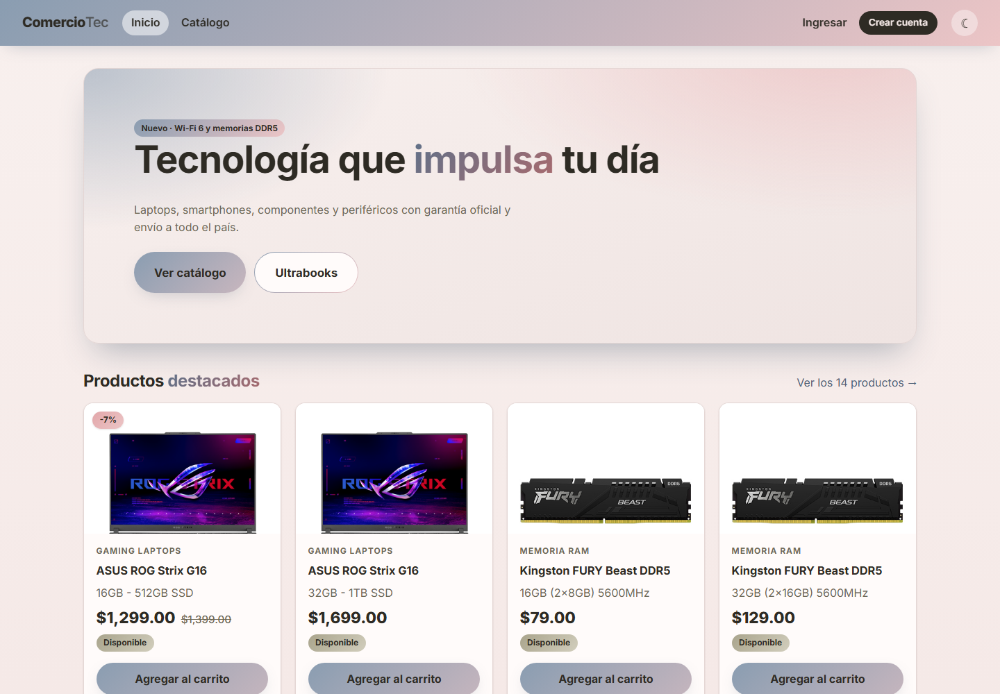
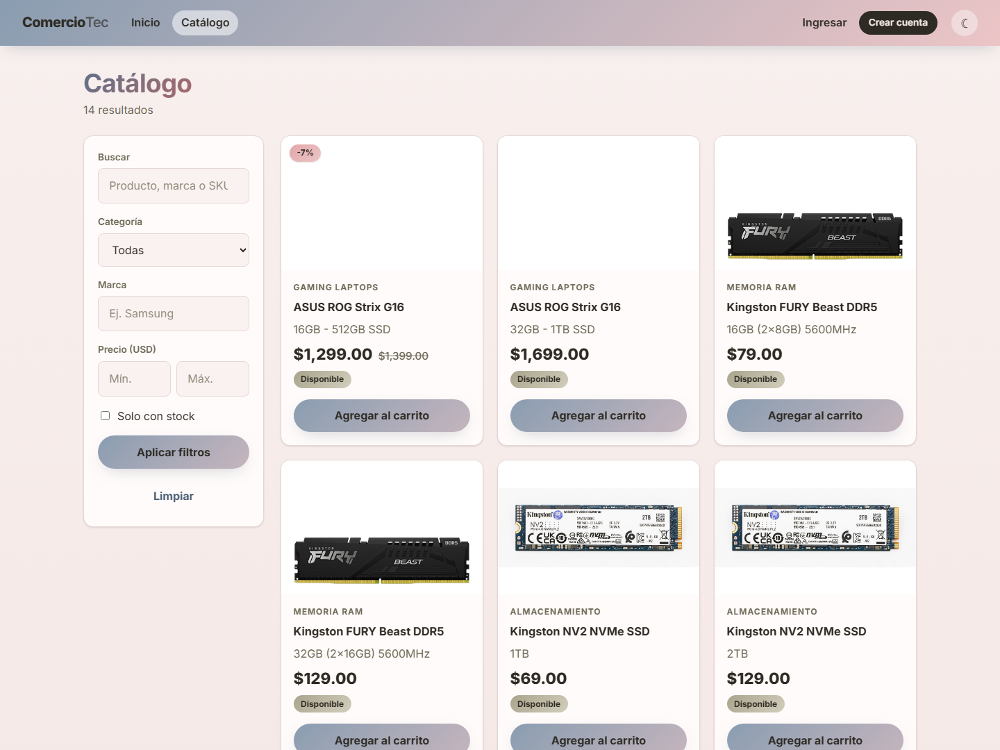
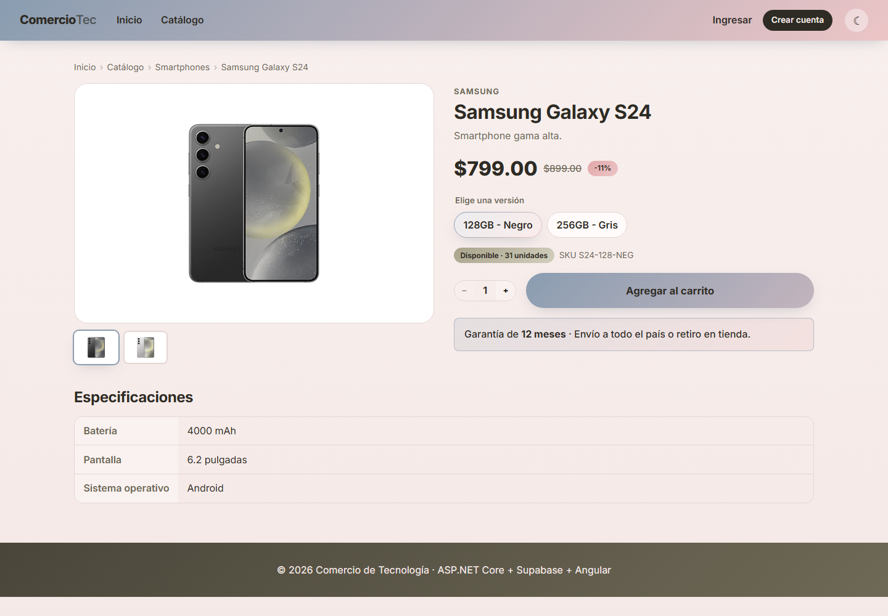
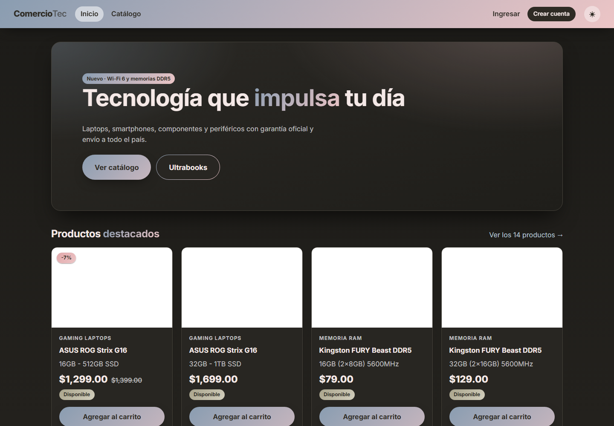
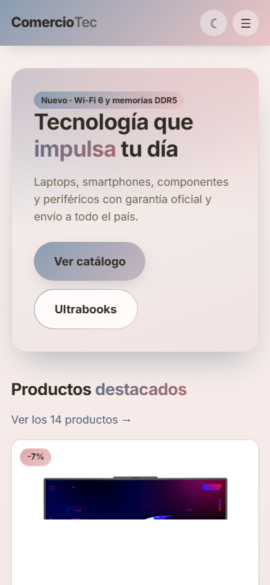

# ComercioTec · Tienda web

Frontend en **Angular 22** de una tienda de tecnología: catálogo con filtros, detalle de producto, carrito, checkout, pedidos y cuenta de usuario.
Consume la API REST **[ComercioTecnologia.API](https://github.com/PixelGenetics/ComercioTecnologia.API)** (ASP.NET Core 8 + PostgreSQL en Supabase), que vive en su propio repositorio.



<p align="center">
  
  
</p>
<p align="center">
  
  
</p>

## Contenido

- [Funcionalidades](#funcionalidades)
- [Tecnologías](#tecnologías)
- [Puesta en marcha](#puesta-en-marcha)
- [Arquitectura](#arquitectura)
- [Estilos y diseño](#estilos-y-diseño)
- [Sesión y manejo de errores](#sesión-y-manejo-de-errores)
- [Rutas](#rutas)
- [Despliegue](#despliegue)

## Funcionalidades

- **Catálogo** con búsqueda, filtros por categoría, marca, rango de precio y stock, y paginación. Los filtros viven en la URL, así que se pueden compartir y funcionan los botones atrás/adelante.
- **Detalle de producto** con galería de fotos, selector de versión (cada versión puede tener su propia foto), stock, cantidad, especificaciones y productos relacionados.
- **Cuenta de usuario**: registro, inicio de sesión con JWT, perfil y direcciones.
- **Carrito** sincronizado con la API: cambiar cantidades, quitar productos, vaciar y aviso de stock insuficiente.
- **Checkout** en tres pasos: dirección de envío (o una nueva en el momento), método de envío y pago con cupón opcional.
- **Mis pedidos** con el detalle de cada uno y su progreso: Pendiente → Pagado → Enviado → Entregado.
- **Imágenes de productos para administradores**: un usuario con rol *Admin* agrega, quita y elige la foto principal desde el detalle del producto.
- **Tema claro y oscuro**: sigue la preferencia del sistema o se elige con el botón de la barra superior, y se recuerda entre visitas.
- **Diseño adaptable** a móvil, con menú desplegable.

## Tecnologías

| | |
|---|---|
| Framework | Angular 22: componentes *standalone*, *signals* y control de flujo `@if` / `@for` |
| Formularios | Reactive Forms con validación |
| HTTP | `HttpClient` con `fetch` e interceptor funcional para el JWT |
| Estilos | CSS propio con variables, sin frameworks; tipografía Inter |
| Lenguaje | TypeScript 6 |

## Puesta en marcha

### Requisitos

- **Node.js 22 LTS o superior** (probado con Node 24) y npm.
- **La API corriendo** en `http://localhost:53654`. Las instrucciones están en [su repositorio](https://github.com/PixelGenetics/ComercioTecnologia.API).

### Instalar y ejecutar

```bash
npm install
npm start
```

Abre <http://localhost:4200>.

En desarrollo, `ng serve` reenvía todas las peticiones `/api/*` a la API mediante [`proxy.conf.json`](proxy.conf.json), así que no hace falta configurar CORS. Si tu API corre en otro puerto, cambia el `target` en ese archivo.

### Scripts

| Comando | Qué hace |
|---|---|
| `npm start` | Servidor de desarrollo con recarga automática |
| `npm run build` | Compilación de producción en `dist/tienda-web/browser` |
| `npm run watch` | Compila en modo desarrollo cada vez que cambia un archivo |

### Datos de prueba

Si cargaste los datos de ejemplo del script de base de datos de la API, puedes entrar con `laura@example.com` / `Tienda123!` (cliente) o `admin@tienda.example.com` / `Tienda123!` (administrador). También puedes crear una cuenta en `/registro`.

Cupones de ejemplo: `BIENVENIDA10` (10 % desde $50) y `TECH20` ($20 desde $200).

## Arquitectura

El código sigue **Clean Architecture**: cada capa solo depende de las que están más adentro.

```
presentation  ──▶  application  ──▶  domain  ◀──  data
 (pantallas)       (casos de uso)    (reglas)     (HTTP, localStorage)
```

```
src/
├── app/
│   ├── domain/            Núcleo: no conoce Angular HTTP ni el navegador
│   │   ├── models/          Entidades: Producto, Carrito, Pedido, Usuario…
│   │   ├── repositories/    Contratos (clases abstractas)
│   │   ├── rules/           Reglas puras: descuento, stock bajo, pasos del pedido, sesión vigente
│   │   └── errors/          ErrorApp, el único tipo de error que ven las pantallas
│   ├── data/              Implementaciones de los contratos
│   │   ├── repositories/    *.http-repository.ts
│   │   ├── storage/         Sesión y tema en localStorage
│   │   ├── http/            URL base y conversión de errores HTTP → ErrorApp
│   │   └── data.providers.ts  Une cada contrato con su implementación
│   ├── application/       Casos de uso y estado con signals: Auth, Carrito, Catálogo, Pedidos, Direcciones
│   ├── core/              Interceptor del JWT y guards de rutas
│   ├── presentation/
│   │   ├── layout/          Plantilla: encabezado, pie y avisos flotantes
│   │   ├── pages/           Una carpeta por pantalla, con su .ts y su .html
│   │   └── shared/          Componentes, servicios de interfaz y utilidades reutilizables
│   ├── app.config.ts      Raíz de composición: router, HTTP y repositorios
│   └── app.routes.ts      Rutas (todas cuelgan de la plantilla principal)
└── styles/                Plantilla de estilos (ver más abajo)
```

Para importar entre capas hay alias definidos en `tsconfig.json`: `@domain/*`, `@data/*`, `@application/*`, `@presentation/*` y `@core/*`.

**Reglas que mantienen la separación:**

- Las pantallas usan los servicios de `application/`; nunca `HttpClient` directamente.
- `application/` depende de los contratos de `domain/repositories`, no de sus implementaciones.
- Solo `data/` habla con la API y con `localStorage`. Para cambiar de backend basta con tocar `data/` y `data.providers.ts`.
- Las reglas del negocio (por ejemplo, que 5 unidades o menos es "stock bajo") viven en `domain/rules/` y no dependen de Angular.

### Agregar una funcionalidad

1. Crea el modelo en `domain/models/` y, si necesita datos de la API, su contrato en `domain/repositories/`.
2. Implementa el contrato en `data/repositories/` y regístralo en `data/data.providers.ts`.
3. Agrega el caso de uso en `application/`.
4. Crea la página en `presentation/pages/<nombre>/` (`.ts` + `.html`) y su ruta en `app.routes.ts`.
5. Pon sus estilos en `src/styles/pages/<nombre>.css` e impórtalo en `src/styles/styles.css`.

## Estilos y diseño

Todos los estilos están en `src/styles/`. Los HTML no llevan estilos en línea.

| Carpeta | Contenido |
|---|---|
| `base/` | `tokens.css` (colores, gradientes, sombras, radios y tema oscuro) y estilos de los elementos HTML |
| `layout/` | Contenedores y columnas, encabezado y pie |
| `components/` | Botones, tarjetas, badges, formularios, alertas, tablas, resumen, opciones, paginación, carga… |
| `pages/` | Ajustes propios de cada pantalla |
| `utilities/` | Clases de una sola responsabilidad: márgenes, tamaños de texto, gradientes |

`styles.css` solo importa los demás archivos, en orden de lo general a lo específico.

**Paleta**

| Color | Hex | Uso |
|---|---|---|
| Azul niebla | `#8A9DB1` | Inicio del gradiente de marca, estado "Pagado" |
| Rosa | `#ECC5C6` | Final del gradiente de marca, ofertas |
| Crema | `#F5E9E7` | Fondo del tema claro, texto del tema oscuro |
| Gris | `#C1C0C2` | "Agotado", estado "Pendiente" |
| Oliva | `#837D68` | "Disponible", estado "Entregado", pie de página |

Son tonos pastel, así que el texto sobre ellos va siempre en tinta oscura (`#2E2B24`); el blanco no tendría contraste suficiente.

- **Tema oscuro:** se activa con `<html data-theme="dark">` (lo pone `TemaService`) o por la preferencia del sistema.
- **Guía visual:** la ruta `/estilos` muestra todas las clases disponibles.
- **Diseño en Figma:** [ComercioTec · Diseño de la tienda](https://www.figma.com/design/wE8usbGJncFzuPVc7P0C5j), con los tokens, la biblioteca de componentes y las pantallas.

## Sesión y manejo de errores

- Al iniciar sesión, la API devuelve un JWT que se guarda en `localStorage` junto con su fecha de expiración. Al recargar, la sesión se restaura solo si sigue vigente.
- `core/interceptors/auth.interceptor.ts` agrega `Authorization: Bearer <token>` a las llamadas a `/api`. Si la API responde **401**, cierra la sesión y lleva al login con `?volver=` para regresar después.
- `autenticadoGuard` protege carrito, checkout, pedidos y cuenta; `invitadoGuard` evita mostrar login y registro con sesión iniciada.
- Los repositorios convierten cualquier error HTTP en un `ErrorApp` con un código (`no-encontrado`, `sin-permiso`, `conflicto`, `validacion`, `sin-conexion`…) y un mensaje listo para mostrar. Si la API no responde, el mensaje lo indica.

## Rutas

| Ruta | Pantalla | Acceso |
|---|---|---|
| `/` | Inicio | Público |
| `/catalogo` | Catálogo. Filtros en la URL: `q`, `categoria`, `marca`, `precioMin`, `precioMax`, `soloConStock`, `pagina` | Público |
| `/productos/:id` | Detalle de producto | Público |
| `/login` · `/registro` | Iniciar sesión · Crear cuenta | Solo sin sesión |
| `/carrito` | Carrito | Con sesión |
| `/checkout` | Finalizar compra | Con sesión |
| `/pedidos` · `/pedidos/:id` | Mis pedidos · Detalle de pedido | Con sesión |
| `/cuenta` | Perfil y direcciones | Con sesión |
| `/estilos` | Guía de estilos | Público |

## Despliegue

`npm run build` genera archivos estáticos en `dist/tienda-web/browser`, que se pueden publicar en Netlify, Vercel, Cloudflare Pages o similar.

El servidor necesita dos reglas:

1. **Reenviar `/api/*` a la API publicada.** Así el código sigue usando `/api` como en desarrollo y no hace falta CORS. La alternativa es cambiar `API_URL` en `src/app/data/http/api.config.ts` y permitir el dominio del frontend en la configuración de CORS de la API.
2. **Servir `index.html` para cualquier otra ruta**, para que funcionen los enlaces directos como `/catalogo` o `/pedidos/2`.

**Netlify** (`netlify.toml` en la raíz del repositorio):

```toml
[build]
  command = "npm run build"
  publish = "dist/tienda-web/browser"

[[redirects]]
  from = "/api/*"
  to = "https://TU-API.onrender.com/api/:splat"
  status = 200
  force = true

[[redirects]]
  from = "/*"
  to = "/index.html"
  status = 200
```

**Vercel** (`vercel.json`):

```json
{
  "buildCommand": "npm run build",
  "outputDirectory": "dist/tienda-web/browser",
  "rewrites": [
    { "source": "/api/:path*", "destination": "https://TU-API.onrender.com/api/:path*" },
    { "source": "/(.*)", "destination": "/index.html" }
  ]
}
```

Reemplaza `TU-API.onrender.com` por el dominio donde publiques la API.

---

Proyecto académico.
